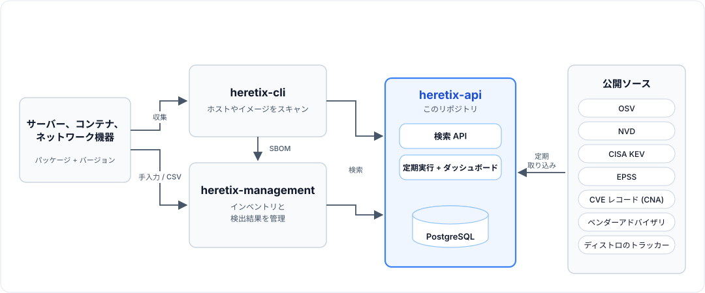
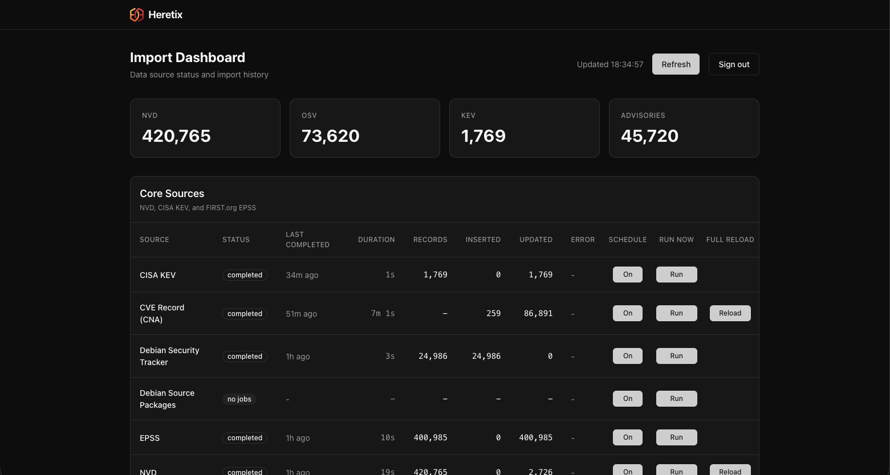

# Heretix API

heretix-api は、**[heretix](https://titeee.github.io/heretix-web/)** の脆弱性データベースです。heretix は、サーバー・コンテナ・ネットワーク機器（ファイアウォール、VPN など）の CVE を 1 つのインベントリで管理する、セルフホスト型のツール群です（Apache-2.0）。

[English README](README.md)

## 概要

パッケージ名とバージョンを指定すると、そのバージョンに該当する脆弱性を返す API です。脆弱性データは各公開ソースから事前に取り込んでおき、そのデータを検索します。

```
GET /api/v1/vulnerabilities/search?package=openssl&version=3.0.2-0ubuntu1.10&ecosystem=Ubuntu:22.04:LTS
→ 46 件。そのうちの 1 件:
  CVE-2024-6119  severity HIGH  distroPriority medium  fixedVersion 3.0.2-0ubuntu1.18  isKev false  epssScore 0.67
```

言語パッケージ（npm、PyPI、Go、Maven など）、Linux ディストリビューションのパッケージ（Debian、Ubuntu、Alpine、RHEL など）、ネットワーク機器や商用製品（FortiOS、PAN-OS、Cisco IOS XE、vCenter など）を検索できます。各脆弱性について、深刻度、悪用状況、修正バージョンを返します。

heretix 全体の構成は次のとおりです。



- **[heretix-cli](https://github.com/TITeee/heretix-cli)**: ホストやコンテナイメージをスキャンし、検出したパッケージを heretix-api で照合します。
- **[heretix-management](https://github.com/TITeee/heretix-management)**: インベントリと検出結果を管理します。
- **heretix-api**（このリポジトリ）: 各公開ソースのデータを定期的に PostgreSQL へ取り込みます。検索時に外部へアクセスすることはありません。

heretix の他のツールと組み合わせずに、単体の脆弱性検索 API として使うこともできます。

### 処理の流れ

1. **取り込み**: 定期ジョブが各ソース（OSV、NVD、CISA KEV、EPSS、CVE レコード、ベンダーアドバイザリ）からデータを取得し、ソースごとのテーブルに保存します。
2. **統合**: 同じ CVE のデータをソースをまたいで 1 件にまとめ、KEV、EPSS、CISA の SSVC 評価といった悪用状況の情報を付与します。
3. **検索**: 指定されたバージョンが各ソースの影響範囲に含まれるかを判定します。バージョンの比較にはエコシステムごとの規則（semver、dpkg、RPM、ベンダー独自の規則）を使います。同じ脆弱性が複数のソースで見つかっても、結果は 1 件にまとめて返します。

## 特長

- **ベンダーアドバイザリ**: Fortinet、Palo Alto Networks、Cisco、Sophos、SonicWall、Oracle CPU、Oracle Linux、Red Hat、Broadcom/VMware、Splunk、Apache HTTP Server、Apache Tomcat、nginx、Zabbix、Check Point、Ivanti、NetScaler、Microsoft（Windows Server、ベータ）
- **ディストリビューション対応**: Linux ディストリビューションのパッケージは dpkg / RPM の規則でバージョンを比較する。ディストリビューション独自の重要度（`distroPriority`）と、「修正予定なし」などの修正状況（`fixStatus`）も返す
- **マルウェア検知**: [ossf/malicious-packages](https://github.com/ossf/malicious-packages) に登録された悪意のあるパッケージ（`MAL-*`）も、脆弱性と同じ方法で検索できる
- **シンプルな構成**: 必要なミドルウェアは PostgreSQL だけ（Redis は不要）。Docker Compose の設定、スケジューラ、取り込み状況のダッシュボードを同梱

## 動作要件

PoC 環境向けの最小構成です（出典: [heretix の要件ページ](https://titeee.github.io/heretix-web/docs/)）。数値は heretix-api と heretix-management の合計で、その大半を heretix-api の PostgreSQL が占めます。

| 項目 | 要件 |
|---|---|
| CPU | 2 vCPU 以上。取り込みや検索の実行中は heretix-api のコンテナが 1 コアの 70% 程度まで使うことがあり、取り込み中は PostgreSQL の負荷も加わる |
| メモリ | 8 GB 以上（推奨 16 GB）。NVD 全件と複数の OSV エコシステムを取り込んだ状態で、heretix-api の PostgreSQL が約 7.7 GB を使用する |
| ディスク | 20 GB 以上。heretix-api のデータベースは、数か月の運用で約 11 GB まで増える。OSV の全エコシステムを取り込む場合は、さらに多めに確保する |
| ソフトウェア | Docker、Docker Compose v2、git |
| ネットワーク | 各公開ソース（nvd.nist.gov、osv.dev、GitHub、各ベンダーのサイト）へアクセスできること |

Docker を使わずに動かす場合（Node.js 22、pnpm、PostgreSQL 15 以上）は、[docs/operations.md](docs/operations.md#native) を参照してください。

## クイックスタート

### 1. 取得と設定

```bash
git clone https://github.com/TITeee/heretix-api.git
cd heretix-api
cp .env.example .env
```

`.env` に次の値を設定します。
- `API_KEY`: API の認証キー。任意の文字列を設定します。リクエスト時は `x-api-key` ヘッダーでこの値を送ります。
- `POSTGRES_PASSWORD`: 同梱の PostgreSQL のパスワード。`.env.example` には無いので、行を追加します。未設定時の `changeme` はローカルでの試用向けなので、独自の値を設定してください。
- `NVD_API_KEY`（任意、推奨）: [NVD の API キー](https://nvd.nist.gov/developers/request-an-api-key)（無料）。設定すると NVD の取り込みが速くなります。

Docker で動かす場合、`.env` の `DATABASE_URL` は使いません。接続先のデータベースは Docker Compose が設定します。

### 2. 起動

```bash
docker compose up --build -d
docker compose ps                    # db と app が起動していることを確認
curl http://localhost:5000/health    # → {"status":"ok",...}
```

初回起動時にデータベースのスキーマが作成され、その後 API がポート 5000 で起動します。ログは `docker compose logs -f app` で確認できます。

### 3. データの取り込み

**起動直後のデータベースは空です。** 定期ジョブは**差分だけ**を取得するため、利用を始める前に初回の取り込みが必要です。`http://localhost:5000/dashboard` の[ダッシュボード](#ダッシュボード)を開き、管理キー（`ADMIN_API_KEY`）を入力してください。取り込みはすべてここから行え、コマンドは不要です。

- **NVD**（全 CVE、約 40 万件）: NVD の行の **Load** を押します。数時間かかり、状態が `running` から `completed` に変わります。途中で失敗しても、もう一度 **Load** を押せば、止まった所から再開します。
- **CISA KEV と EPSS**: NVD の完了後に **Run** を押します。取り込み済みの CVE に情報を追加するものなので、NVD より後に実行します。2 回目以降は毎日自動で更新されます。
- **OSV**: 「OSV Ecosystems」で、スキャンするエコシステム（`npm`、`PyPI`、`Ubuntu` など。[名前の選び方](docs/data-sources.md#which-name-to-import)）を選び、**Add and load** を押します。毎日のジョブが On になり、全件が取り込まれます。
- **そのほかのソース**（ベンダーアドバイザリ、Debian security tracker `debian-tracker`）: ジョブを **On** にして、**Run** を一度押します。CVE レコード（`cna`、約 600 MB のダウンロード）と Microsoft（`advisory-microsoft`）は、NVD と同じく、初回はボタンが **Load** になります。

コマンド（`docker compose exec app pnpm import:nvd full`、`pnpm import:osv ecosystem <名前>`）も使えます。スクリプトからの実行や、最初から取り込み直すときに使います。

取り込むソースの選び方は [docs/data-sources.md](docs/data-sources.md#choosing-what-to-import) を参照してください。

### 4. 検索

```bash
export API_KEY=<設定したキー>
curl -H "x-api-key: $API_KEY" \
  "http://localhost:5000/api/v1/vulnerabilities/search?package=lodash&version=4.17.20&ecosystem=npm"
```

検索結果に反映されるのは、取り込みが完了したソースのデータです。

### 停止と更新

```bash
docker compose down                        # 停止（データは残る。-v を付けると削除）
git pull && docker compose up --build -d   # 最新版に更新
```

起動時には、データベースのマイグレーションとデータのバックフィルを適用してから API を起動します。データ量が多い環境では、バックフィルに数分かかることがあります。

## 使い方

`/health` と `/dashboard`（画面）を除き、すべてのエンドポイントで `x-api-key` ヘッダーが必要です。

```bash
# Linux ディストリビューションのパッケージ
curl -H "x-api-key: $API_KEY" \
  "http://localhost:5000/api/v1/vulnerabilities/search?package=bzip2-libs&version=1.0.8-8.el9&ecosystem=Red%20Hat:9"

# ネットワーク機器（ベンダーアドバイザリ）
curl -H "x-api-key: $API_KEY" \
  "http://localhost:5000/api/v1/vulnerabilities/search?package=FortiOS&version=7.4.3"

# ID を指定して取得
curl -H "x-api-key: $API_KEY" "http://localhost:5000/api/v1/vulnerabilities/CVE-2021-44228"
```

`ecosystem` の指定によって、検索するソースとバージョンの比較方法が変わります。検索結果に漏れがないかを判断する前に、[エコシステム別の検索動作](docs/api.md#search-behavior-by-ecosystem)を確認してください。

| エンドポイント | 用途 |
|---|---|
| `GET /api/v1/vulnerabilities/search` | パッケージとバージョンに該当する脆弱性の検索 |
| `POST /api/v1/vulnerabilities/search/batch` | 最大 1,000 パッケージの一括検索 |
| `GET /api/v1/vulnerabilities/search/cpe` | CPE 2.3 による検索（NVD） |
| `GET /api/v1/vulnerabilities/suggest` | パッケージ名の候補 |
| `GET /api/v1/catalog` | 製品カタログ(選択画面用) |
| `GET /api/v1/vulnerabilities/:id` | CVE、OSV、ベンダーアドバイザリの ID による詳細の取得 |
| `GET /api/v1/vulnerabilities/stats` | 件数の統計 |
| `POST /api/v1/jobs/:source/run`、`PATCH /api/v1/jobs/:source` | 取り込みジョブの手動実行、有効・無効の切り替え |

レスポンスの全項目を含むリファレンスは [docs/api.md](docs/api.md)（英語）にあります。

## サポート対象の OS リリース

次のリリースに対する検索は、精度の検証と不具合修正の対象です。

| ディストリビューション | リリース |
|---|---|
| Debian | 11、12、13、14 |
| Ubuntu | 20.04、22.04、24.04、26.04 LTS |
| Alpine | v3.21 〜 v3.24 |
| AlmaLinux / Rocky Linux | 8、9、10 |
| Red Hat Enterprise Linux | 8、9、10 |
| Windows Server（ベータ） | 2016、2019、2022、2025（デスクトップ版と Server Core） |

Windows Server はベータ版です。実機数台でしか確認しておらず、リリースではなく、フルの OS ビルドで検索します。Windows 10 / 11 は対象外です。

それ以外のリリースのデータも**削除しません**。精度の検証は行いませんが、ベストエフォートで検索できます。Oracle Linux も同じ扱いです。npm や PyPI などの言語エコシステムは対象外（この方針の影響を受けません）。理由、ディストリビューションごとの注記、一覧の見直し方は [docs/data-sources.md](docs/data-sources.md#supported-os-releases)（英語）にあります。

## ダッシュボード

`http://localhost:5000/dashboard` では、ソースごとの取り込み状況と件数を確認できます。ソースの各行には、3つのボタンが列ごとに並びます。**Schedule**（On/Off）は毎日の定期実行の切り替え、**Run now** は手動での一回の実行（前回からの差分。未読み込みのときは初回の取り込みで、ボタンは **Load**）、**Full reload** は全件を読み直して保存済みのデータに上書きします（実行前に確認が出ます）。レコードの読み方が変わり、保存済みのデータもそれに合わせたいとき（たとえば CVE レコードをより多く読めるようになった更新のあと）に使います。事前に削除はしないので、実行中も検索は使えます。データを表示するには、画面右上で API キーを入力する必要があります。



## データ収集

初期状態で定期実行されるのは NVD、KEV、EPSS だけです。ほかのソースは、必要なものを On にしてください。

| ソース | 内容 | スケジュール（UTC） |
|---|---|---|
| NVD | 全 CVE、CPE による影響範囲、CVSS | 2 時間ごと |
| CISA KEV | 悪用が確認されている脆弱性 | 毎日 09:00 |
| EPSS | 悪用される確率の予測値 | 毎日 10:00 |
| OSV | 言語エコシステム、Linux ディストリビューション、マルウェア | 毎日 08:00（エコシステムごとに 1 ジョブ） |
| CVE レコード（CNA） | CNA が登録した影響製品、CISA の SSVC 評価 | 毎日 15:30 |
| Red Hat | OVAL（RHEL 8/9）、CSAF VEX（未修正の CVE と RHEL 10 全体） | 毎日 13:15 – 15:00 |
| Debian security tracker | 修正状況（`no-dsa`、`ignored` など） | 毎日 07:15 |
| ベンダーアドバイザリ | Fortinet、PAN、Cisco、Oracle、Broadcom など | 毎日 11:00 – 16:00 |

ソースごとの詳細、取り込みコマンド、制約事項は [docs/data-sources.md](docs/data-sources.md)（英語）を参照してください。

## ドキュメント

詳細なドキュメントは英語のみです。

| ドキュメント | 内容 |
|---|---|
| [docs/api.md](docs/api.md) | API リファレンス、検索の動作 |
| [docs/data-sources.md](docs/data-sources.md) | データソースごとの取り込み方法、コマンド、注意点 |
| [docs/operations.md](docs/operations.md) | セットアップ、環境変数、スケジューラ、バックフィル、バックアップと作り直し、トラブルシューティング |
| [docs/tls-proxy.md](docs/tls-proxy.md) | HTTPS で公開する手順: リバースプロキシ、HSTS、`TRUST_PROXY`、DB のパスワード |
| [docs/architecture.md](docs/architecture.md) | データモデル、重複排除、バージョンの照合 |
| [docs/known-issues.md](docs/known-issues.md) | 既知の制約 |
| [ACCURACY.md](ACCURACY.md) | 公式アドバイザリを正解データとした適合率・再現率の測定結果 |
| [CONTRIBUTING.md](CONTRIBUTING.md) | 開発環境、テスト、ベンダーの追加方法 |

## ライセンス

Apache License 2.0。詳細は [LICENSE](LICENSE) を参照してください。
